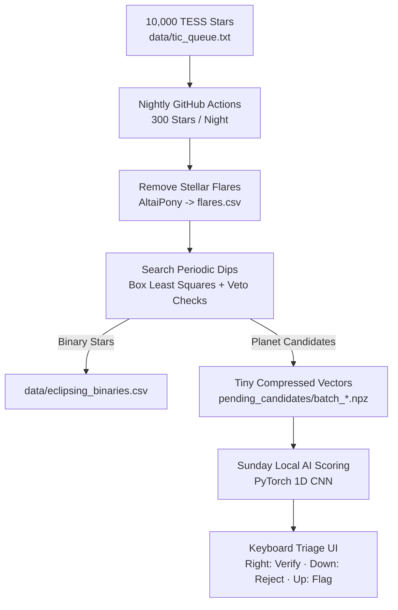

# TESS Planet Hunter


I built **TESS Planet Hunter** after reading [Pavel Rabtsevich's story](https://www.reddit.com/r/ClaudeAI/comments/1wzw8zd/i_think_i_found_a_planet_nobody_knew_existed_i/) about hunting an undiscovered exoplanet in open NASA satellite data and getting hooked on the idea. I didn't want a project that needed babysitting all week, so I decided to automate the search and only spend an hour or two on Sundays reviewing results.

There was just one catch: I quickly realized that finding planets means reading hundreds of noisy star-brightness graphs — and I had no idea how to read a light curve yet. Instead of giving up or eyeballing raw noise, I automated *that* part too: a nightly GitHub Actions pipeline cleans and pre-filters 300 NASA TESS stars a day, a lightweight PyTorch 1D CNN scores the most planet-like dips, and a keyboard-driven dark-mode UI lets me review the top candidates in 15 minutes every Sunday.

---

## What It Looks For

Every night, the pipeline downloads brightness recordings (light curves) of 300 stars observed by NASA's TESS space telescope and catches three things:

1. **Exoplanet Candidates (Main Target):** When a planet crosses in front of its star, the star's light dips slightly at regular intervals, forming a clean, flat-bottomed **U-shaped** dip. These are saved as compact `.npz` files under `pending_candidates/`.
2. **Stellar Flares (Byproduct):** Sudden magnetic explosions on stars that spike in seconds and fade over hours. I detect and cut these out *first* (using `AltaiPony`) so they don't ruin the planet search, and log them to `data/flares.csv`.
3. **Eclipsing Binaries (Byproduct):** Pairs of stars orbiting and eclipsing each other. They look like planets at first glance, get caught by my analytical veto checks, and are logged to `data/eclipsing_binaries.csv`.

---

## How It Works

Saving raw NASA FITS files in Git would blow up the repo in days, and feeding noisy raw light curves straight into a neural network produces too many false alarms. So I split the system into **three simple stages**:



- **Stage 1 — Nightly Cloud Filter (Automated):** Every night at 03:00 UTC, GitHub Actions picks up where it left off (`data/cursor.txt`), downloads the next 300 stars in batches from MAST, masks flares, flattens stellar variability, runs Box Least Squares (BLS), and filters out obvious binary stars. Only lightweight numeric vectors (kilobytes, no images or raw FITS) are committed back to the repo.
- **Stage 2 — Local 1D CNN (`AstroNet1D`):** Instead of turning light curves into 2D images, I treat them like EKG signals. A compact dual-branch PyTorch 1D CNN looks at both the full orbit (201 points), a zoomed-in view of the dip (61 points), and 6 physical properties of the star and transit, giving each candidate a 0–100% score.
- **Stage 3 — Sunday Keyboard Review (`triage.py`):** A fast dark-mode window shows the top-scoring candidates one by one. `Right` verifies, `Down` rejects, `Up` flags for a closer look on ExoFOP-TESS, and `Left` undoes if I hit the wrong key.

---

## Model Results & Lessons Learned

I trained the model on **500 labeled NASA TESS stars** (`250` planet candidates, `250` false positives) pulled from the NASA Exoplanet Archive (`toi` catalog), using a strict **70% train / 15% validation / 15% test** split with feature scaling fit *only* on the training set.

| Metric (Unseen Test Set, n=75) | Result |
| :--- | :---: |
| Validation ROC-AUC | **0.836** |
| Test ROC-AUC | **0.785** |
| Test Precision (Planet Candidates) | **81.5%** |
| Avg. Score on Real Planets vs. False Alarms | **59.2% vs. 32.1%** |

A few real bugs I hit and fixed along the way:
- **Flattening window trap:** Early on I used `window_length=101` for 2-minute TESS data — which is only ~3.3 hours! That accidentally smoothed away real 2–6 hour planet transits. Increasing it to `501` (~16.7 hours) immediately jumped my unseen test AUC from `0.67` to `0.785`.
- **Overfitting on small data:** My first CNN had ~140k parameters for a few hundred stars. Switching to a compact `16.4k`-parameter architecture with `AdaptiveAvgPool + AdaptiveMaxPool` closed the gap between validation and test scores.
- **Keeping CI fast & free:** GitHub Actions doesn't need PyTorch to scan stars, so I split dependencies into `requirements-worker.txt` (lightweight astronomy tools) and `requirements.txt` (full local ML setup).

---

## Want to Run It Yourself?

You can fork this repo and run your own nightly planet hunt in about 20 minutes:

### 1. Set up your local environment
```bash
git clone https://github.com/CemreMetin/tess-planet-hunter.git
cd tess-planet-hunter

python -m venv venv
# Windows PowerShell:
.\venv\Scripts\Activate.ps1
# macOS / Linux:
# source venv/bin/activate

pip install torch --index-url https://download.pytorch.org/whl/cpu
pip install -r requirements.txt
```

### 2. Build your star queue & train the model (one-time setup)
```bash
# Pull 10,000 real TESS SPOC star IDs from MAST
python scripts/build_queue.py --count 10000

# Download 500 labeled NASA TOI light curves (~15 min)
python -m ai.prepare_data --limit 250

# Train, evaluate on unseen test stars, and plot ROC/PR curves
python -m ai.train
python -m ai.evaluate
python -m ai.curves
```

### 3. Turn on the nightly automation
In your GitHub repo:
1. Go to **Settings → Actions → General → Workflow permissions** and enable **Read and write permissions**.
2. Go to **Actions → Nightly TESS Hunter → Run workflow** to test your first cloud run.

### 4. Your weekly Sunday routine (~15 min)
```bash
git pull
python -m ai.predict
python triage.py
```

---

## Project Layout

```text
.
├── .github/workflows/nightly_hunt.yml   # Nightly 03:00 UTC GitHub Actions job
├── pipeline/
│   ├── preprocessing.py                 # Fast batch MAST downloader & view binning
│   ├── vetos.py                         # Odd-even, radius & secondary eclipse filters
│   └── worker.py                        # Nightly scanner (AltaiPony + BLS)
├── ai/
│   ├── prepare_data.py                  # NASA TOI training dataset builder
│   ├── augmentation.py                  # Light curve data augmentation
│   ├── model.py                         # Compact PyTorch 1D CNN (AstroNet1D)
│   ├── train.py                         # Train/val/test trainer + scaler export
│   ├── evaluate.py                      # Unseen test evaluation & confusion matrix
│   ├── curves.py                        # ROC & Precision-Recall curve plots
│   └── predict.py                       # Scores nightly batches for triage
├── scripts/
│   └── build_queue.py                   # Generates data/tic_queue.txt from MAST
├── triage.py                            # Dark-mode keyboard candidate reviewer
├── requirements.txt                     # Local environment (PyTorch + Astronomy)
└── requirements-worker.txt              # Lightweight CI environment (no PyTorch)
```

---

## Credits
- Satellite data from the **NASA TESS Mission** via **MAST** and the **NASA Exoplanet Archive**.
- 1D CNN architecture inspired by **AstroNet** (Shallue & Vanderburg, 2018).
